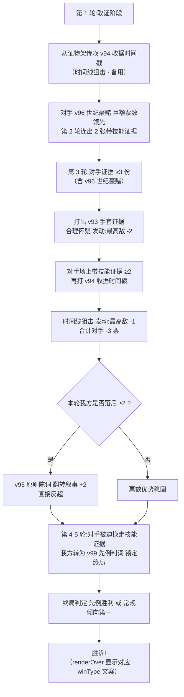

# 封神技 · 多元化胜利 —— 设计文档

> 本文件对应需求 2 项交付物:
> 1. **技能重构** — 律师式技能(含真实案例设计注解 `src`)
> 2. **胜利条件多元化** — 先例胜利 / 陪审团否决
>
> 配套代码: `shared/game-core.js`(引擎)、`public/client.js` + `singleplayer.html`(渲染)、`server.js`(视图导出)
>
> **历史变更**:原「法庭黑天鹅」行为触发事件系统(e55-e59)已按奥卡姆原则移除(见 `git log`),本文件不再包含该章节。

---

## 一、技能重构:从"选战"到"法庭"的叙事迁移

原 30 个技能为竞选主题(演说家/网络喷子/全民偶像…),保留其机制数值作为基础层;
新增 10 个**封神技**(③级为主)+ 3 个**质证链技能**,全部以真实传奇律师/案件为设计锚点。

### 1.1 质证链技能(日常法庭交锋)

| 技能 | 等级 | 效果 | 真实案例设计注解 (`src`) |
| --- | --- | --- | --- |
| **交叉询问** `crossExam` | ② | 相邻敌方证人 -1 票;若其带丑闻额外 -1 | 佩里·梅森式质证:问题早已知道答案,只等证人自投罗网 |
| **反对!** `objection` | ① | 对方亮出 ②/③ 级技能牌时,最高敌 -1 票 | 法庭反对程序:程序正义的日常武器 |
| **证人信誉崩塌** `credCollapse` | ② | 对方有丑闻牌时,最高敌 -2 票 | 富尔曼信誉崩塌:伪证史让整条证据链作废 |
| **内部吹哨人** `whistleblower` | 结算后 | 丑闻最高的对方 -1⊙ 且丑闻 +1 | 弗兰克·瑟皮科:体制内吹哨人扳倒整个系统 |

### 1.2 封神技(③级,传奇律师招牌战术)

| 技能 | 效果 | 真实案例设计注解 (`src`) |
| --- | --- | --- |
| **合理怀疑** `reasonableDoubt` | 对方场上证据 ≥3 → 最高敌 -2 | 约翰尼·科克伦的"手套论"(辛普森案):"戴不上,就无罪" |
| **时间线狙击** `timelineSnipe` | 对方带技能的证据 ≥2 → 最高敌 -1 | 库鲁亚马(梅南德斯案):用商店收据时间戳击穿不在场证明 |
| **翻转叙事** `flipNarrative` | 本方落后 ≥2 → 本方 +2 | 格里·斯宾塞(红宝石山脊案):把"事实之争"翻转成"原则之争" |
| **职业生涯赌局** `careerGamble` | 本方 +2;若未领先则丑闻 +1 | 达登的"手套试验"豪赌:赌上职业生涯的最后一击 |
| **确立先例** `precedent` | 本方 +1,记录先例标记 | 曼斯菲尔德勋爵(萨默塞特案):一次判决改变一个时代的法律 |
| **陪审团否决** `juryNull` | 本方 +1,获得 1 名陪审员 | 威廉·佩恩与曾格案:陪审团拒绝适用恶法,人民之诉 |

### 1.3 配套卡牌(v91–v100)

| 卡牌 | 技能 | 费用 | 标签 |
| --- | --- | --- | --- |
| v91 质证记录 | 交叉询问 | 3⊙ | 法律·学术·精英 |
| v92 反对理由书 | 反对! | 2⊙ | 法律·程序·学术 |
| v93 手套证据 | 合理怀疑 | 5⊙ | 法律·名人·媒体 |
| v94 收据时间戳 | 时间线狙击 | 4⊙ | 法律·科技·证据 |
| v95 原则陈词 | 翻转叙事 | 4⊙ | 法律·平权·媒体 |
| v96 世纪豪赌 | 职业生涯赌局 | 5⊙ | 法律·名人·媒体 |
| v97 伪证前科档案 | 证人信誉崩塌 | 4⊙ | 法律·挖料·媒体 |
| v98 吹哨人档案 | 内部吹哨人 | 3⊙ | 法律·腐败·媒体 |
| v99 先例判词 | 确立先例 | 5⊙ | 法律·传统·学术 |
| v100 人民之诉 | 陪审团否决 | 4⊙ | 法律·平权·民粹 |

---

## 三、胜利条件多元化

`finishGame(state, opts)` 现支持三种路径,优先级:

```
陪审团否决 (juryNull)  >  先例胜利 (precedent)  >  常规倾向 (support)
```

### 3.1 先例胜利 `precedentSeat`
- 触发:任意一方打出 v99「先例判词」→ `state.precedentSeat = seat` 且 `winType='precedent'`
- 终局判定:即使该方倾向落后,只要触发过先例 → **直接胜诉**
- 法理依据:**遵循先例 (stare decisis)** — 英美法系中,一次具有里程碑意义的判决
  (如萨默塞特案废除英格兰奴隶制)的效力超越当下民调。
- 博弈点:先例是"护身符",对手知道"拖到终局对方必赢",会逼迫对方提前换走/压制该卡。

### 3.2 陪审团否决 `juryTokens`
- 触发:v100「人民之诉」每次 +1 票并获得 1 名陪审员;集满 3 名 → **立即胜诉**
  (`doCountContinue` 内即时判定,不等 5 轮结束)
- 法理依据:**Jury Nullification** — 陪审团有权拒绝适用其认为不义的法律,
  典型案例:William Penn 案(1670)与 Zenger 案(1735)。
- 博弈点:3 名陪审员需要跨 3 轮稳定打出,容易被对手用「证据排除/换位」干扰;
  但成功即秒杀,是"慢速攒牌 vs 常规票数"的节奏博弈。

### 3.3 常规支持度(原规则)
- 5 轮结束,支持度最高者胜诉。

### 3.4 状态字段(server 视图导出)
`makeView` 新增导出:`precedentSeat` / `juryTokens` / `winType`(渲染端用于徽章与结算屏文案)。

---

## 四、Perry Mason Moment 演示流程

> **设计目标**:复刻"收集特定证据 → 适当时机使用「合理怀疑」→ 触发「时间线狙击」最终翻盘"的经典庭审高潮。



**演示要点**:
1. **收集**:早期囤 v94 收据时间戳 + v91 质证记录(双保险);
2. **时机**:对手连出带技能证据且证据数 ≥3 时,才是"合理怀疑"的完美窗口;
3. **连招**:`合理怀疑(-2)` 与 `时间线狙击(-1)` 可叠加对同一最高敌目标结算,
   单轮最多 -3 票,足以逆转;
4. **兜底**:若仍未反超,`翻转叙事(+2)` 提供第三重保障;
5. **终局**:先例判词把优势兑换成"判例护身符",杜绝尾盘被翻。

---

## 五、测试覆盖(`_test_skill_combos.js`)

| 组合 | 验证点 | 断言数 |
| --- | --- | --- |
| A | fan/troll 结算顺序 | 2 |
| B | orator/megaScandal + 对照(tagBoost 正常发动) | 3 |
| C | tagNull 失效 + 对照 | 4 |
| D | 合理怀疑 触发/不触发边界 + 对照 | 2 |
| E | 先例标记写入 + 票数 | 2 |
| F | 陪审员累积 3 名立即胜诉 + winType | 5 |
| G | finishGame 先例胜利(落后仍胜) + 常规对照 | 2 |
| I | 位置博弈系(v101 首座 / v102 末席 / v103 左翼 / v104 抽签) | 7 |
| J | 收入分发(榜首 -1 / 末位 +1 / 保底 +1)+ 逐人日志 | 3 |

全部 16 项测试 / 25 项断言通过(`node --test _test_skill_combos.js`)。
