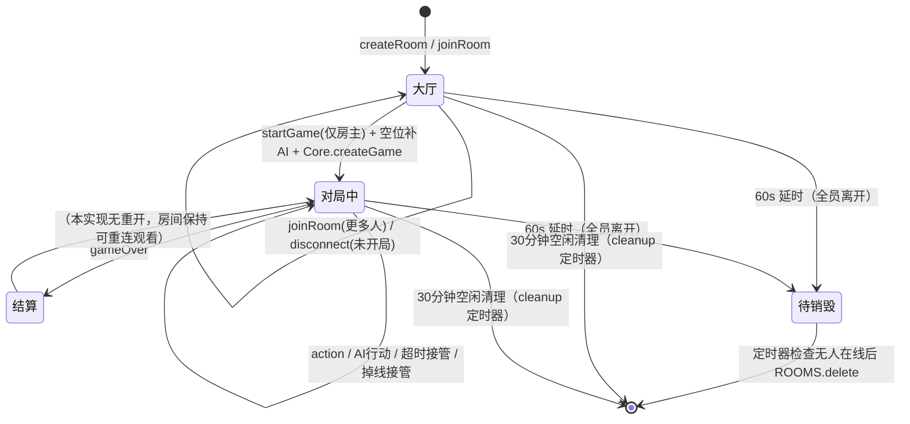
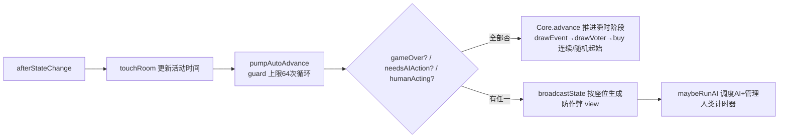

# server.js 房间生命周期与 AI 接管机制

> 评审任务 4 交付物。基于 `server.js` 实际代码绘制（函数名/常量与源码一致）。

## 0. 数据结构

| 全局 | 类型 | 作用 |
|---|---|---|
| `ROOMS` | `Map<code, room>` | 房间表，`code` 为 6 位大写邀请码 |
| `SOCK_TO_ROOM` | `Map<socketId, {code, seat}>` | socket → 房间座位绑定（一个 socket 同时只能在一间房） |

`room` 对象关键字段：
`code / mode(solo|multi) / maxSeats(2-4) / seats[] / state / started / hostSeat / lastActivity`
`timers: Map<seat, timeout>`（人类超时定时器）、`deadlines: Map<seat, timestamp>`（广播倒计时，防无限重置）、
`aiRetries: Map<seat, n>`（AI 连续行动重试）、`aiBusy: Set<seat>`（防 AI 重入）、`aiQueue: Promise`（房间级串行队列）。

## 1. 房间生命周期状态机



- 空闲清理：`setInterval` 每 5 分钟扫一次，`now - room.lastActivity > 30min` → 通知+删房。
- 全员离开：`disconnect` 中若 `!room.seats.some(s => s.connected)` → 清计时器 → 60s 后若仍无人则删房（防误删短时重进）。

## 2. Socket 事件流

```mermaid
flowchart TD
    A[客户端 connect] --> B{createRoom?}
    B -- 是 --> C[生成邀请码 + 房主入座0]
    C --> C2[broadcastRoom 广播座位表]
    B -- 否 --> D{joinRoom}
    D -- 房间不存在 --> D1[ack 房间不存在]
    D -- 已开始 --> E{同名且断线?}
    E -- 是(重连) --> E1[恢复座位 connected=true<br/>取消AI接管 isAI=false<br/>清除 aiBusy/aiRetries/旧timer<br/>afterStateChange 恢复调度]
    E -- 否 --> D2[ack 对局已开始]
    D -- 未开始 --> F{空位?}
    F -- 有 --> F1[入座 + join(code)]
    F -- 无 --> F2[ack 房间已满]
    D1 --> Z[ack 结果]
    D2 --> Z
    F1 --> Z
    C2 --> G{startGame?}
    G -- 是 --> G1[空位补AI<br/>Core.createGame(seed/names/aiMask)<br/>started=true]
    G1 --> G2[afterStateChange: touchRoom→pumpAutoAdvance→broadcastState→maybeRunAI]
    G -- 否 --> H{action?}
    H -- 是 --> H1[Core.apply 校验+结算]
    H1 -- ok --> H2[pushLogs + afterStateChange]
    H1 -- 失败 --> H3[ack 错误信息]
    H -- 否 --> I{disconnect?}
    I -- 是 --> I1[seats[seat].connected=false]
    I1 --> I2{对局中且未结束?}
    I2 -- 是 --> I3[isAI=true 接管<br/>房主转移<br/>afterStateChange]
    I2 -- 否 --> I4[座位清空 + 房主转移]
    I4 --> I5{全员离开?}
    I5 -- 是 --> I6[清timer + 60s后删房]
```

## 3. AI 接管与超时决策

```mermaid
flowchart TD
    S[maybeRunAI] --> S1{needsAIAction?}
    S1 -- 有AI座位 --> A[scheduleAI 逐座位]
    S1 -- 无 --> S2{humanActing?}
    S2 -- 有人类 --> T1{该座位已有timer?}
    T1 -- 否 --> T2[setTimeout onTimeout 30s<br/>SEAT_TIMEOUT_MS]
    T1 -- 是 --> S3[保持现有 deadline 不重置]

    A --> A1{aiBusy 含该座位?}
    A1 -- 是(防重入) --> S
    A1 -- 否 --> A2[aiBusy.add + 挂入 aiQueue 串行链<br/>等待 AI_INTERVAL=900ms]
    A2 --> A3{执行前复查<br/>仍为AI? 未gameOver?}
    A3 -- 否(已重连) --> A9[跳过本次行动, 交还人类]
    A3 -- 是 --> A4{aiRetries ≥ 3?}
    A4 -- 是 --> A5[forceSkip 强制跳阶段 + 日志]
    A4 -- 否 --> A6[Core.aiAct 决策]
    A6 --> A7{行动后仍需要AI?}
    A7 -- 是 --> A8[aiRetries+1]
    A7 -- 否 --> A10[aiRetries 清零]
    A5 --> A11[finally: aiBusy.delete + broadcastThink(false)<br/>afterStateChange]
    A8 --> A11
    A10 --> A11
    A9 --> A11

    T2 --> B[onTimeout]
    B --> B1{超时座位是AI? 或已不需行动?}
    B1 -- 是(守卫) --> S3
    B1 -- 否 --> B2[pushLogs ⏰超时<br/>seats[seat].isAI = true]
    B2 --> A[scheduleAI 接管本回合]
```

### 关键守卫（防死循环/防误伤）
1. **aiBusy 重入锁**：同一座位排队期间不会被重复调度。
2. **执行前复查**：排队等待期间若玩家重连（`isAI` 恢复 `false`）→ 跳过本次"幽灵 AI 行动"，交还控制权。
3. **aiRetries ≥ 3**：连续多次行动后仍需要 AI → `forceSkip` 强制推进阶段（防状态机卡死）。
4. **onTimeout 双守卫**：座位已是 AI、或已不再需要行动（阶段已推进）→ 不接管，避免把人类永久变 AI。
5. **deadline 复用**：`broadcastState` 只在 `deadline` 过期/缺失时重设，人类玩家不会因频繁广播而"永不超时"。

## 4. 推进泵



## 5. 房间快照持久化（服务器重启恢复）

> Task 3 交付物。基于 `shared/room-snapshot.js` + `server.js` 实际代码。

### 5.1 触发点

| 时机 | 动作 |
|---|---|
| 启动（`listen` 回调） | `restoreRooms()`：读 `rooms-snapshot.json` → `deserializeRooms`（按 30 分钟空闲阈值过滤过期房）→ 填回 `ROOMS` → 对进行中房间重跑 `maybeRunAI`（人类座位无 socket，30s 超时接管兜底） |
| 每 10 分钟（`setInterval` 定时器，`.unref()`） | `snapshotRooms()` → `writeSnapshotFile(__dirname, ROOMS)`（tmp + rename 原子替换） |
| 进程退出（`SIGINT`/`SIGTERM`/`exit`） | 同上落盘（Windows 强杀/断电不触发信号，靠定时落盘兜底，最多丢一个间隔内的变更） |

`SNAP_INTERVAL_MS` 可用环境变量覆盖（测试/运维场景，如 `SNAP_INTERVAL_MS=1500`）。

### 5.2 序列化契约（`shared/room-snapshot.js`，纯函数、require 无副作用）

- **只写可 JSON 字段**：`code/mode/maxSeats/password/seed/hostSeat/started/lastActivity/seats/state/snapshots`。
- **`seats[].connected` 强制写 `false`**：服务器重启后所有玩家处于"断线态"，同名 `joinRoom` 走重连分支（取消 AI 接管、恢复快照、`↩ 已为你恢复掉线前的手牌与市场`）。
- **断线快照一并持久化**：`snapshots: [{seat, state, savedAt}]`，重启后掉线玩家重连仍能恢复私有资源。
- **运行时对象不落盘**：`timers/deadlines/aiRetries/aiBusy/aiQueue` 由 `factory`（`createRoom`）重建空实例。
- 房间号正则校验 `/^[A-Z2-9]{4}$/`（排除 0/1 防混淆）；损坏/缺失快照文件返回空数组并告警，不阻塞启动。

### 5.3 恢复后行为

- 恢复的房间 `started=true` 且对局未结束 → `maybeRunAI(room)`：为每个需要行动的人类座位设 30s 超时（`SEAT_TIMEOUT_MS`），期间同名重连取消接管。
- 超过 `CLEANUP_IDLE_MS`（30 分钟）无活动的房间不恢复（与空闲清理语义一致）。
- `ROOMS.size >= MAX_ROOMS` 时停止恢复（防止快照撑爆内存上限）。

### 5.4 验证

- `_test_snapshot.js`（node:test，纯函数）：serialize → write → read → deserialize 完整往返；损坏文件优雅降级。
- `_tmp_snap_smoke.js`（临时脚本，用完即删）：建房开局 → 定时落盘 → 强杀（模拟断电）→ 重启 → `/api/rooms` 房间恢复 → 同名重连回到断线前阶段。
