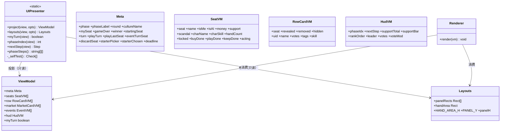

# UI 渲染层解耦 — UIPresenter 渐进式重构路线图

> 评审任务 1 交付物。参考实现：`public/UIPresenter.js`（UMD，浏览器/Node 双可用）。
> 原则：**渐进迁移、零破坏**——本文件可独立加载与单测，两端渲染逻辑在迁移完成前保持不变。

## 1. 为什么不全量重构

`client.js`（~2900 行）与 `singleplayer.html` 的渲染函数直接读 `view`/`game` 原始字段，
这是历史演进的自然结果。一次性把 `renderGame/renderPanels/renderHud/renderBottom`
全部改为消费 ViewModel 属于"高风险大爆炸式重构"：

- 两端渲染器签名不同（联机全局 ctx vs 单机 ctx 首参），迁移需双份适配；
- 布局函数（`rowLayout/handLayout/marketSlotRects/panelRect`）与 FX 引擎（`checkFxDiffs`）
  深度耦合，牵一发动全身；
- 当前版本已经历 12 轮回归验证，稳定性是资产，不应为架构洁癖冒险。

因此本方案交付：**可运行的投影层参考实现 + 自检 + 迁移三步法**，
让后续迭代可以在小步、可回滚的前提下完成解耦。

## 2. 类图



## 3. 迁移三步法

### 第 1 步：接入投影（已完成交付，零视觉变化）
```html
<!-- index.html：在 client.js 之前引入（singleplayer.html 同理可内联） -->
<script src="UIPresenter.js"></script>
```
```js
// client.js render() 顶部（防御性，加载失败不影响现有渲染）
vm = (window.UIPresenter && UIPresenter.project(view, { mySeat, compact, W, H, deadline })) || null;
```
迁移前的每个渲染函数都能访问 `vm`，先读先改。

### 第 2 步：数据源替换（每个渲染函数独立进行，可回滚）
以 `renderHud` 的阶段进度条为例：

```js
// 重构前（直读原始状态）
const idx = PHASE_STEPS.findIndex(s => s[0] === view.phase);
// 重构后（消费 ViewModel）
const idx = vm.hud.phaseIdx;
const next = vm.hud.nextStep;           // {0:阶段id, 1:中文名} 或 null
```
同理替换：`renderPanels` → `vm.seats[]`（含 `acting/leading/scandal` 已算好）、
`renderMarket` → `vm.market`、`renderLogs` → `vm.meta`、连任 👑 徽章 → `vm.hud.leader === i`、
支持度轨道 → `vm.hud.supportBar`、任务指引 → `vm.myTurn`。
每替换一个函数，跑一次静态检查 + 用户手动对局验证，再继续下一个。

### 第 3 步：布局函数搬入（可选）
`layouts(view, opts)` 已提供 `panelRects/handArea` 骨架；`rowLayout/handLayout/marketSlotRects`
的完整公式可从两端现有函数平移（注意两端 `drawPixelText` 签名差异）。

## 4. 防作弊一致性

- `view.seats[i].hand` 由服务端 `makeView` 对非我方置 `null`；`project()` 沿用该约定，
  `handCount` 仅 `isMe` 时有效，他人手牌内容/数量绝不进入 ViewModel。
- 行牌 `card.hidden` 同理：暗置牌 `uid/name/votes/tags/skill` 全部置空。
- 市场仅投影己方 `seats[mySeat].market`。

## 5. 性能权衡

- Canvas 全量重绘是主开销，ViewModel 每帧重建为 O(n)（n=座位数+行牌数），可忽略。
- `checkFxDiffs` 已有 `view.version === lastV` 短路（`client.js` 2667 行），
  版本号脏检查已存在；**不建议改为哈希**——哈希是值快照，会破坏"按 uid 找出新增/移除牌"
  的对象引用比较逻辑，且现有 diff 只在 version 变化时执行，本就低频。

## 6. 收益

| 收益 | 说明 |
|---|---|
| 可单测 | `UIPresenter.project()` 纯函数，node 环境直接验证投影正确性（见 `_selfTest`） |
| 单一事实源 | `myTurn/phaseIndex/nextStep` 两端逻辑收敛，杜绝漂移 |
| 渐进可控 | 每个渲染函数独立迁移、独立回滚，风险隔离 |
| 为后续 | 若引入 DOM/新渲染后端（如 WebGL），只需换 Renderer，投影层不变 |
